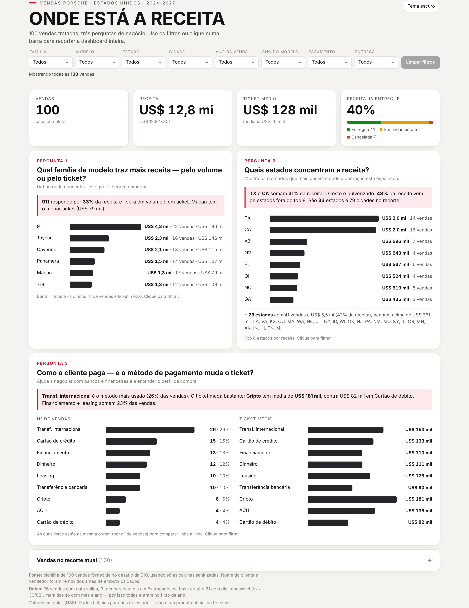
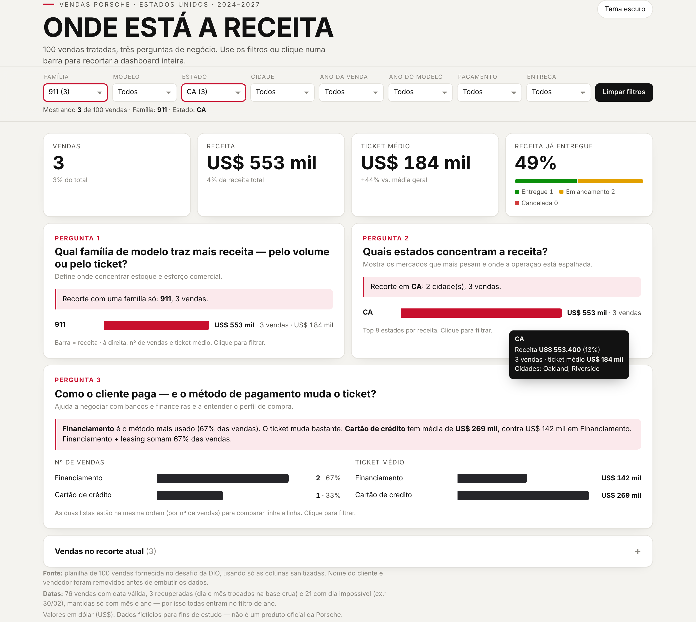

# Dashboard de vendas Porsche

Dashboard interativa, em um único `index.html`, feita a partir de uma planilha de 100 vendas da Porsche nos EUA. Desafio da DIO: transformar a planilha numa dashboard publicada na web, guiada por perguntas de negócio.

**Dashboard no ar:** https://prgheitoraraujo.github.io/Porsche/



## Perguntas de negócio

| # | Pergunta | Por que escolhi | Como a dashboard responde |
|---|---|---|---|
| 1 | **Qual família de modelo traz mais receita, pelo volume ou pelo ticket?** | É a decisão de estoque e de onde colocar esforço comercial. Saber se uma família ganha por vender muito ou por vender caro muda a estratégia. | Barras de receita por família, com nº de vendas e ticket médio do lado. |
| 2 | **Quais estados concentram a receita?** | Mostra quais mercados pesam mais e se a operação depende de poucos lugares. | Top 8 estados por receita, e o resto resumido numa linha. |
| 3 | **Como o cliente paga, e o método de pagamento muda o ticket?** | Serve pra negociar com bancos e financeiras e pra entender o perfil de compra. | Duas listas na mesma ordem: nº de vendas e ticket médio por método. |

Cada pergunta tem uma frase de conclusão que se recalcula com o filtro. Com a base completa:

- **911** responde por **33%** da receita e lidera em volume e em ticket (US$ 186 mil). Macan tem o menor ticket (US$ 79 mil).
- **TX e CA** somam **31%** da receita, mas o resto é pulverizado: **43%** vem de 25 estados fora do top 8.
- **Transferência internacional** é o método mais usado (26%). O ticket muda bastante: **cripto** tem média de **US$ 181 mil**, contra US$ 82 mil no cartão de débito.

### Indicadores de topo

Nº de vendas, receita, ticket médio e **% da receita já entregue**, com uma barra de status (entregue / em andamento / cancelada).

### Filtros

Família, modelo, estado, cidade, ano da venda, ano do modelo, pagamento e status de entrega. Clicar numa barra também filtra. Cada opção mostra quantas vendas tem no recorte atual, e a tabela no fim lista as vendas filtradas.

**Exemplo de filtro aplicado:** família 911 + estado CA (clicando na barra), 3 vendas, ticket 44% acima da média geral.



## Tratamento da base

A planilha veio com cada campo em duas versões, a crua e a sanitizada. O script [`scripts/preparar_base.py`](scripts/preparar_base.py) faz o tratamento e embute o resultado no `index.html`:

1. **Só colunas sanitizadas** (+ `sale_id`).
2. **Preço, ano do modelo e milhas em número.** Na base crua estavam como `$121k`, `68.900 dollars`, `twenty twenty four`, `Miles: 6,400`.
3. **Dados pessoais removidos.** `customer_name` e `salesperson` saem, porque a base vai embutida no HTML. A coluna de vendedor nem foi sanitizada (72 grafias pra poucos nomes).
4. **Família do modelo.** 40 modelos viram 6 famílias: 911, 718, Cayenne, Macan, Taycan e Panamera.
5. **Status de entrega agrupado.** 10 status viram 3 grupos: Entregue, Em andamento e Cancelada.
6. **Segunda regra para as datas `INVALID`** (24 de 100), olhando a data crua:
   - `2024/15/07` → dia e mês trocados → **recuperada** como 15/07/2024 (3 casos);
   - `February 30th, 2026` → dia impossível, mas ano e mês legíveis → **parcial**, só mês e ano (21 casos).

   Com isso, todas as 100 vendas entram no filtro de ano da venda. Na tabela, as datas recuperadas e parciais aparecem marcadas.

Saída limpa: [`data/vendas_porsche_tratada.csv`](data/vendas_porsche_tratada.csv). As planilhas originais estão em [`data/`](data/).

Para refazer:

```bash
pip install pandas openpyxl
python scripts/preparar_base.py
```

> Observação: a base é fictícia e tem vendas datadas até 2027.

## Ferramenta usada

**Agente com skill.** Usei um agente de IA (Claude) com a base anexada e uma skill de visualização de dados, que define regras de tipo de gráfico, cor, rótulos, hover e acessibilidade. O agente tratou a base com Python, gerou o HTML, abriu a página num navegador headless pra tirar os prints e corrigiu o que ficou ruim.

O prompt final e o que mudou em cada iteração estão em [`docs/prompt.md`](docs/prompt.md).

## Estrutura

```
index.html                       dashboard (arquivo único, dados embutidos)
scripts/preparar_base.py         tratamento da base + embute os dados no HTML
data/porsche_base_crua.xlsx      base original, crua
data/porsche_base_sanitizada.xlsx base com colunas cruas + sanitizadas
data/vendas_porsche_tratada.csv  base final usada na dashboard
docs/prompt.md                   prompt e iterações
docs/prints/                     prints da dashboard
```

## Stack

HTML, CSS e JavaScript puro, sem framework e sem biblioteca de gráfico. Fonte Archivo (Google Fonts). Tratamento em Python com pandas. Publicado no GitHub Pages.
